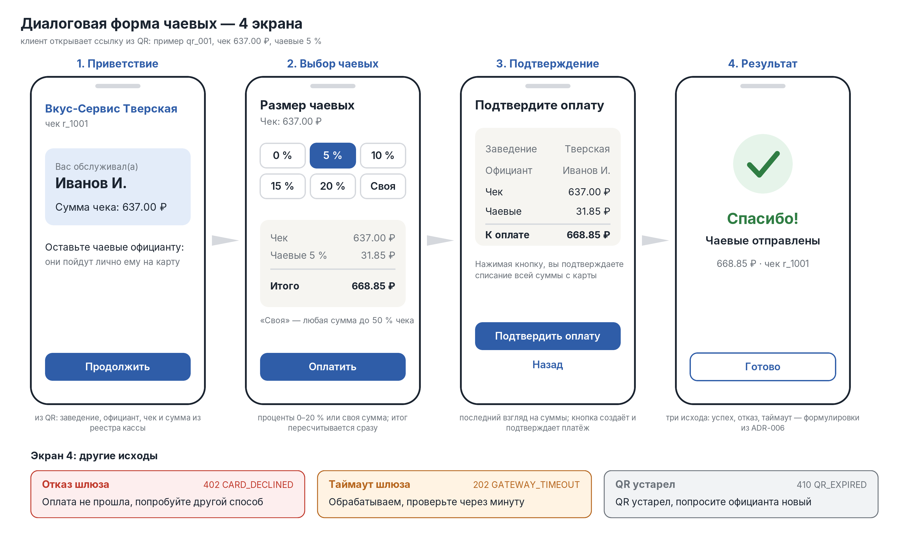

# QR и диалоговая форма чаевых — кейс 3

Заполненная копия шаблона [06_qr_and_tip_dialog](../case/06_qr_and_tip_dialog.md). Основания:
[ADR-003](adr-003-trust-boundary.md) (подпись в ссылке, сумма из кассы), [ADR-004](adr-004-validation-order.md)
(порядок проверок), [ADR-009](adr-009-secrets-time-ttl.md) (ключ, время, TTL), API — `api/05_api_schemas.yaml`.
Генерация QR работает в прототипе: команда `qr` (тест T3-10, T3-11).

## 1. Payload QR

| Поле | Источник | Пример (qr_001) | Зачем |
|-|-|-|-|
| merchant_id | merchants.csv | m_001 | идентификатор мерчанта; мерчант должен быть ACTIVE |
| employee_id | employees.csv | e_001 | кому пойдут чаевые; официант принадлежит этому мерчанту |
| receipt_id | реестр чеков кассы | r_1001 | привязка к чеку; по нему сервер берёт сумму |
| nonce | случайные 6 hex | c82561 | одноразовость: после SUCCESS по QR новый платёж невозможен |
| exp | время выпуска + 24 ч | 2025-11-01T23:59:00Z | после этого момента QR недействителен (`QR_EXPIRED`) |
| signature | HMAC-SHA256, 16 hex | 68d0f361ac38c12b | защита от подделки: изменить любое поле без ключа нельзя |

Сумма чека в payload **не входит**: сервер берёт её из реестра кассы по паре (`merchant_id`, `receipt_id`),
а клиентская сумма только сверяется ([ADR-003](adr-003-trust-boundary.md)). Добавить сумму в подпись можно в версии 2.

## 2. Подпись

```python
import hmac, hashlib
payload = f"{merchant_id}|{employee_id}|{receipt_id}|{nonce}|{exp}"
signature = hmac.new(SECRET, payload.encode(), hashlib.sha256).hexdigest()[:16]
```

Для qr_001: `m_001|e_001|r_1001|c82561|2025-11-01T23:59:00Z` → `68d0f361ac38c12b` (совпадает с `qr_links.csv`).
`SECRET` берётся из `TIPS_HMAC_SECRET`, в коде и в Git его нет. Сравнение — `hmac.compare_digest`.
Подпись обрезана до 64 бит: ради короткой ссылки; подбор онлайн нереален при rate limit (ADR-009).

## 3. Генерация QR и платёжной ссылки

1. Мерчант или официант (на себя) запрашивает QR на чек: `POST /api/v1/qr {merchant_id, employee_id, receipt_id}`.
   В прототипе — команда `qr`; сумму чека в запросе присылает «касса» (поле `amount`).
2. Сервер проверяет условия (ниже) и создаёт `qr_id`, `nonce`, `exp`, вычисляет `signature`.
3. Записывает QR в `qr_links` (в прототипе — `qr_out.csv`) и новый чек в реестр (`receipts_out.csv`).
4. Формирует ссылку `https://tips.example/pay?qr={qr_id}&sig={signature}` и QR-код с ней.
5. Возвращает ссылку и картинку (в API — `qr_png_base64`; в прототипе — PNG-файл, если установлена утилита `qrencode`).

**Проверки при генерации:**

| Проверка | Если нарушена | Код |
|-|-|-|
| формат `m_NNN`, `e_NNN`, `r_NNNN`, сумма — число | не выпускать | VALIDATION_ERROR, 400 |
| мерчант существует и `status = ACTIVE` | не выпускать | NOT_FOUND, 404 / MERCHANT_BLOCKED, 403 |
| официант существует и принадлежит этому мерчанту | не выпускать | NOT_FOUND, 404 / ACCESS_DENIED, 403 |
| сумма чека в пределах `0 < x ≤ 1 000 000` | не выпускать | AMOUNT_OUT_OF_RANGE, 422 |
| `receipt_id` уникален для мерчанта: чек уже есть в реестре с другой суммой | не выпускать | AMOUNT_MISMATCH, 422 |
| на чек уже есть действующий QR | вернуть его, второй не выпускать | — (200, `new = false`) |
| действующий QR выпущен на другого официанта | не выпускать | ACCESS_DENIED, 403 |

После истечения `exp` на тот же чек можно выпустить новый QR (связь Receipt → QR — 1:N).

```bash
export TIPS_HMAC_SECRET=demo-secret-k3
echo '{"merchant_id":"m_001","employee_id":"e_001","receipt_id":"r_2001","amount":1250.50}' > qr.json
python3 prototype/04_прототип.py --now 2025-11-01T18:00:00Z qr qr.json
```

## 4. Диалоговая форма выбора чаевых (4 экрана)



Макет собран из данных qr_001: заведение «Вкус-Сервис Тверская», официант Иванов И., чек r_1001 на 637.00 ₽, чаевые 5 %.
Пересборка: `python3 diagrams/build_dialog.py`, затем `convert -density 192 diagrams/dialog.svg diagrams/dialog.png`.

| Экран | Что показывает | Действие клиента | Вызов API |
|-|-|-|-|
| **1. Приветствие** | название заведения, имя официанта, номер и сумма чека | «Продолжить» | `GET /api/v1/qr/{qr_id}?sig=` → QRResponse |
| **2. Выбор чаевых** | кнопки 0 / 5 / 10 / 15 / 20 % и «Своя»; итог пересчитывается при выборе | выбирает процент или вводит сумму, «Оплатить» | — (расчёт на экране, сервер пересчитает) |
| **3. Подтверждение** | чек, чаевые, итог к оплате | «Подтвердить оплату» (или «Назад») | `POST /api/v1/tips`, затем `POST /payments/{id}/confirm` |
| **4. Результат** | итог оплаты, см. таблицу ниже | «Готово» | при таймауте — `GET /payments/{id}` |

Правила формы:
- «Своя» принимает любую сумму от 0 до 50 % чека; больше — `TIP_OUT_OF_RANGE`, поле подсвечивается.
- Ключ идемпотентности (`idempotency_key`) создаётся один раз при нажатии «Оплатить» и повторяется при ретраях;
  двойное нажатие на кнопку не создаёт второй платёж.
- Сумму чека форма берёт из ответа сервера и не даёт её менять.

**Экран 4, исходы** (тексты — [ADR-006](adr-006-error-catalog.md)):

| Исход | HTTP / код | Текст | Что дальше |
|-|-|-|-|
| успех | 200, SUCCESS | «Спасибо! Чаевые отправлены» | конец |
| отказ шлюза | 402, CARD_DECLINED | «Оплата не прошла, попробуйте другой способ» | вернуться на экран 2 |
| таймаут шлюза | 202, GATEWAY_TIMEOUT | «Обрабатываем, проверьте через минуту» | опрос статуса; через 15 минут сверка закроет платёж |
| QR устарел | 410, QR_EXPIRED | «QR устарел, попросите официанта новый» | новый QR у официанта |
| прочие ошибки | 4xx | «Не удалось открыть оплату» | подробности только в логах |

## 5. Критерий приёмки

- [x] Payload QR содержит 6 полей с объяснением
- [x] Подпись HMAC-SHA256, а не простой хеш; ключ из окружения
- [x] TTL QR ≤ 24 ч, nonce одноразовый (гасится на SUCCESS)
- [x] Описаны 4 экрана диалога, есть макет
- [x] Указаны проверки при генерации QR; генерация реализована в прототипе и проверена тестами T3-10, T3-11
