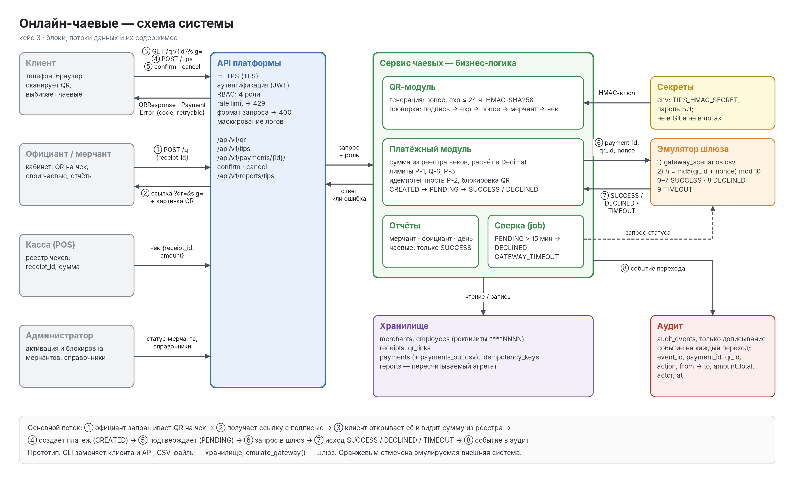

# A.1. Схема системы

Исходник для правки в draw.io: `diagrams/system.drawio`. SVG и PNG пересобираются командой
`python3 diagrams/build_system.py`, после чего PNG экспортируется через
`convert -density 192 diagrams/system.svg diagrams/system.png`.

## Блоки

| Блок | Что это | Что передаёт |
|-|-|-|
| Клиент | браузер на телефоне, без установки приложения | открывает ссылку `qr + sig`, выбирает чаевые, создаёт и подтверждает платёж с `idempotency_key` |
| Официант / мерчант | кабинет сотрудника заведения | запрос QR на чек (`receipt_id`), получает ссылку и картинку QR, смотрит свои чаевые и отчёты |
| Касса (POS) | кассовая система мерчанта | чек `{receipt_id, amount}` в реестр: источник суммы (ADR-003) |
| Администратор | оператор платформы | статус мерчанта (активация, блокировка), справочники |
| API платформы | единая точка входа | TLS, JWT, RBAC, rate limit, проверка формата; передаёт в сервис проверенный запрос и роль |
| Сервис чаевых | бизнес-логика из четырёх модулей | QR-модуль: генерация и проверка HMAC. Платёжный модуль: суммы, лимиты, идемпотентность, статусы. Отчёты. Сверка |
| Эмулятор шлюза | заменитель платёжного шлюза (ADR-001) | получает `{payment_id, qr_id, nonce, amount_total}`, возвращает SUCCESS / DECLINED / TIMEOUT |
| Секреты | переменные окружения | `TIPS_HMAC_SECRET` для QR-модуля, пароль БД |
| Хранилище | БД (в прототипе CSV) | merchants, employees, receipts, qr_links, payments, idempotency_keys, reports |
| Аудит | журнал, в который только дописывают | событие на каждый переход: `event_id, payment_id, qr_id, action, from_status, to_status, amount_total, actor, at` |

## Потоки

| № | Откуда → куда | Данные | Результат |
|-|-|-|-|
| ① | Официант → API → QR-модуль | `POST /api/v1/qr {merchant_id, employee_id, receipt_id}` | проверки: мерчант ACTIVE, официант этого мерчанта, чек есть в реестре |
| ② | QR-модуль → официант | `https://tips.example/pay?qr=qr_001&sig=68d0f361ac38c12b` + картинка | запись в qr_links: nonce, exp ≤ 24 ч, signature |
| ③ | Клиент → API → QR-модуль | `GET /api/v1/qr/{id}?sig=` | QRResponse: имя официанта, сумма из реестра, варианты чаевых. Ошибки 422 / 410 / 409 / 403 |
| ④ | Клиент → платёжный модуль | `POST /api/v1/tips {qr_id, receipt_id, base_amount, tip_pct, idempotency_key}` | 201 Payment (CREATED) или 200 при повторе того же ключа |
| ⑤ | Клиент → платёжный модуль | `POST /api/v1/payments/{id}/confirm` или `/cancel` | CREATED → PENDING или CREATED → CANCELED |
| ⑥ | Платёжный модуль → эмулятор | `{payment_id, qr_id, nonce, amount_total}` | — |
| ⑦ | Эмулятор → платёжный модуль | SUCCESS / DECLINED (`CARD_DECLINED`) / TIMEOUT | статус в payments, ответ 200 / 402 / 202 |
| ⑧ | Сервис → аудит | событие перехода | одна запись на каждый переход, в одной транзакции с ним |
| — | Сверка → эмулятор | запрос статуса для PENDING | через 15 мин без ответа: DECLINED, `GATEWAY_TIMEOUT` |

## Соответствие прототипу

| Блок схемы | В прототипе |
|-|-|
| Клиент + API | CLI `04_прототип.py qr.json` |
| QR-модуль | `load_qr()`, `verify_signature()`, `check_exp()` |
| Платёжный модуль | `calc_amounts()`, идемпотентность, `write_payment()` |
| Эмулятор | `emulate_gateway()` + `data/gateway_scenarios.csv` |
| Хранилище | `merchants.csv`, `employees.csv`, `qr_links.csv`, `payments.csv` (только чтение), `payments_out.csv` |
| Аудит | `audit_out.csv` (предлагается добавить) |
