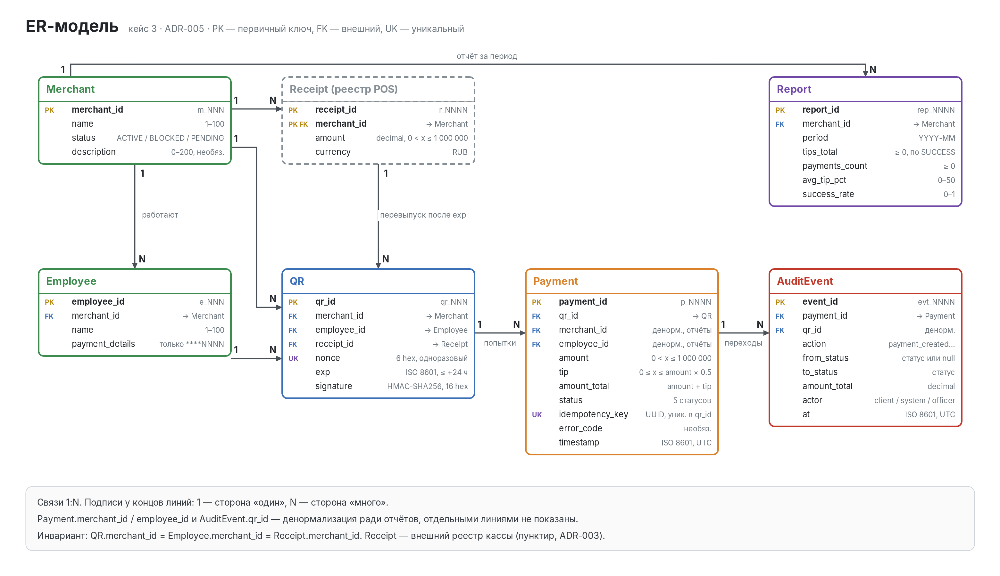

# A.2. ER-модель

Исходник для draw.io: `diagrams/er.drawio`. Пересборка: `python3 diagrams/build_er.py`,
затем `convert -density 192 diagrams/er.svg diagrams/er.png`. Решения описаны в ADR-005.
Этот файл — заполненный шаблон `08_errors.md` (несмотря на имя, в нём ER-модель).

## 1. Сущности

| Сущность | Что хранит | Зачем |
|-|-|-|
| Merchant | merchant_id, name, status, description | справочник заведений; от статуса зависит, можно ли платить (Q-4) |
| Employee | employee_id, merchant_id, name, маска реквизитов | кому идут чаевые; реквизиты только для выплат и только маской |
| QR | ссылка на оплату чека: официант, чек, nonce, срок, подпись | точка входа клиента; подпись защищает от подделки, nonce — от повтора |
| Payment | попытка оплаты: суммы, статус, ключ идемпотентности | факт оплаты чаевых, основа отчётов |
| Report | агрегаты мерчанта за месяц | быстрая отчётность; всегда пересчитывается из Payment |
| AuditEvent | каждый переход статуса платежа | разбор инцидентов, доказательство для споров |
| Receipt (внешняя) | сумма чека из кассы | источник суммы, которому сервер доверяет (ADR-003) |

## 2. Атрибуты

### 2.1. Merchant (образец, без изменений)

| Поле | Тип | PK/FK | Обяз. | Ограничение |
|-|-|-|-|-|
| merchant_id | string | **PK** | да | `m_NNN` |
| name | string | — | да | 1–100 |
| status | enum | — | да | ACTIVE / BLOCKED / PENDING |
| description | string | — | нет | 0–200 |

### 2.2. Employee

| Поле | Тип | PK/FK | Обяз. | Ограничение |
|-|-|-|-|-|
| employee_id | string | **PK** | да | `e_NNN` |
| merchant_id | string | FK → Merchant | да | мерчант существует |
| name | string | — | да | 1–100, не уникально («Иванов И.» у пяти мерчантов) |
| payment_details | string | — | да | только маска `****NNNN`; полные реквизиты у провайдера выплат |

### 2.3. QR

| Поле | Тип | PK/FK | Обяз. | Ограничение |
|-|-|-|-|-|
| qr_id | string | **PK** | да | `qr_NNN` |
| merchant_id | string | FK → Merchant | да | мерчант ACTIVE на момент генерации |
| employee_id | string | FK → Employee | да | `employee.merchant_id = qr.merchant_id` |
| receipt_id | string | FK → Receipt | да | `r_NNNN`, уникален в пределах мерчанта |
| nonce | string | UK | да | 6 hex; погашен, если по QR есть Payment в SUCCESS |
| exp | datetime | — | да | ISO 8601 UTC, `exp ≤ created_at + 24 ч` |
| signature | string | — | да | первые 16 hex от HMAC-SHA256(`merchant_id\|employee_id\|receipt_id\|nonce\|exp`) |

Погашение nonce — производное состояние: отдельной колонки нет, и `qr_links.csv` не меняется.
В БД его обеспечивает уникальный частичный индекс: не больше одного Payment в SUCCESS на `qr_id`.

### 2.4. Payment

| Поле | Тип | PK/FK | Обяз. | Ограничение |
|-|-|-|-|-|
| payment_id | string | **PK** | да | `p_NNNN`; новые начинаются с `p_0101` |
| qr_id | string | FK → QR | да | для seed выводится по номеру: `p_000N → qr_00N` |
| merchant_id | string | FK → Merchant | да | денормализация, равен `qr.merchant_id` |
| employee_id | string | FK → Employee | да | денормализация, равен `qr.employee_id` |
| amount | decimal | — | да | > 0, ≤ 1 000 000, совпадает с Receipt.amount |
| tip | decimal | — | да | ≥ 0, ≤ amount × 0.5, `ROUND_HALF_UP` |
| amount_total | decimal | — | да | amount + tip, ≤ 2 000 000 |
| status | enum | — | да | CREATED / PENDING / SUCCESS / DECLINED / CANCELED |
| idempotency_key | string | UK (с qr_id) | да | UUID v4 |
| error_code | string | — | нет | код из ADR-006 |
| timestamp | datetime | — | да | ISO 8601 UTC |

В `payments.csv` (seed) только 7 колонок: payment_id, merchant_id, employee_id, amount, tip, status, timestamp.
Остальные четыре есть только в `payments_out.csv`.

### 2.5. Report

| Поле | Тип | PK/FK | Обяз. | Ограничение |
|-|-|-|-|-|
| report_id | string | **PK** | да | `rep_NNNN` |
| merchant_id | string | FK → Merchant | да | UK вместе с period |
| period | string | — | да | `YYYY-MM` |
| tips_total | decimal | — | да | ≥ 0, только SUCCESS |
| payments_count | int | — | да | ≥ 0, все попытки |
| avg_tip_pct | decimal | — | нет | 0–50, только SUCCESS; null, если успешных нет |
| success_rate | decimal | — | да | 0–1 |

Контроль на данных: m_001 за 2025-11 даёт 414.85 / 6 / 9.00 / 0.83 (ADR-007).

### 2.6. AuditEvent

| Поле | Тип | PK/FK | Обяз. | Ограничение |
|-|-|-|-|-|
| event_id | string | **PK** | да | `evt_NNNN` |
| payment_id | string | FK → Payment | да | — |
| qr_id | string | FK → QR | да | денормализация, для разбора по QR |
| action | enum | — | да | payment_created / payment_submitted / payment_confirmed / payment_declined / payment_canceled |
| from_status | enum | — | нет | null для payment_created |
| to_status | enum | — | да | статус после перехода |
| amount_total | decimal | — | да | сумма на момент события |
| actor | enum | — | да | client / system / officer |
| at | datetime | — | да | ISO 8601 UTC |

Таблица только дописывается: UPDATE и DELETE для неё запрещены правами БД.

### 2.7. Receipt (внешний реестр кассы)

| Поле | Тип | PK/FK | Обяз. | Ограничение |
|-|-|-|-|-|
| receipt_id | string | **PK** (вместе с merchant_id) | да | `r_NNNN` |
| merchant_id | string | **PK**, FK → Merchant | да | — |
| amount | decimal | — | да | > 0, ≤ 1 000 000 |
| currency | string | — | да | `RUB`; поле нужно для выхода на рынок ЮВА |

## 3. Связи

| Связь | Тип | Обоснование |
|-|-|-|
| Merchant → Employee | 1:N | в заведении несколько официантов, официант работает у одного мерчанта |
| Merchant → QR | 1:N | QR выпускаются на чеки заведения; связь хранится явно ради проверки при генерации |
| Employee → QR | 1:N | официант обслуживает много чеков |
| Receipt → QR | 1:N | после истечения `exp` на тот же чек можно выпустить новый QR |
| QR → Payment | 1:N | после DECLINED или CANCELED по тому же QR возможна новая попытка (ADR-002) |
| Merchant → Report | 1:N | один отчёт на мерчанта за каждый период |
| Payment → AuditEvent | 1:N | каждый переход статуса — отдельное событие |

## 4. Критерий приёмки

- [x] 6 сущностей описаны, плюс внешняя Receipt
- [x] Для каждой сущности указаны PK/FK, типы и ограничения
- [x] Связи описаны с типом и обоснованием
- [x] `payment_details` — только маска `****NNNN`
- [x] `signature` — HMAC-SHA256, а не простой хеш
- [x] Диаграмма в draw.io с PK/FK и связями
