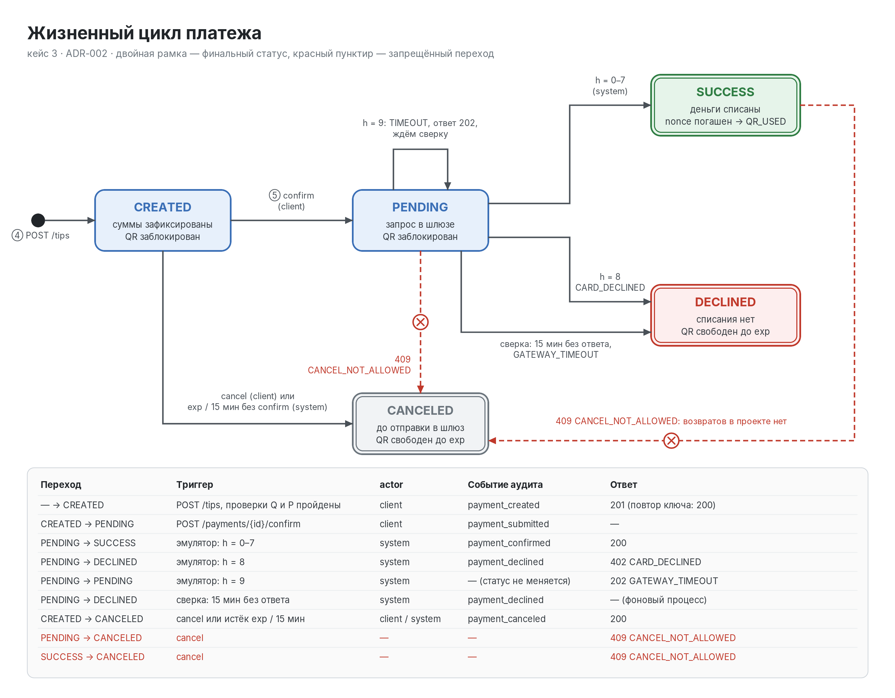

# A.3. Схема состояний платежа

Исходник для draw.io: `diagrams/states.drawio`. Пересборка: `python3 diagrams/build_states.py`,
затем `convert -density 192 diagrams/states.svg diagrams/states.png`. Решение описано в ADR-002.

## Как читать

- Двойная рамка — финальный статус: SUCCESS, DECLINED и CANCELED больше не меняются.
- Красный пунктир с ✕ — запрещённый переход, сервер отвечает 409 `CANCEL_NOT_ALLOWED`.
  Его рисуем намеренно: в шаблоне 07 строки PENDING → CANCELED и SUCCESS → CANCELED
  есть в матрице, и жюри должно увидеть, что они продуманы, а не забыты.
- Петля на PENDING — ответ эмулятора h = 9. Статус не меняется, клиент получает 202,
  событие аудита не пишется, потому что перехода нет.
- В PENDING ведут два выхода: отказ шлюза (h = 8) и сверка через 15 минут.
  Оба дают DECLINED, отличаются кодом: `CARD_DECLINED` или `GATEWAY_TIMEOUT`.

## Что происходит с QR

| Статус платежа | QR |
|-|-|
| CREATED, PENDING | заблокирован: новая попытка получает 409 `PAYMENT_IN_PROGRESS` |
| SUCCESS | nonce погашен: дальше 409 `QR_USED` |
| DECLINED, CANCELED | свободен до `exp`, можно платить снова |

## Связь с тестами

| Тест | Путь по схеме |
|-|-|
| T3-1 Успех | — → CREATED → PENDING → SUCCESS |
| T3-2 Отказ | — → CREATED → PENDING → DECLINED (h = 8) |
| T3-3 Неверный QR | платёж не создаётся, на схему не попадает |
| T3-4 Повтор | — → CREATED один раз, второй запрос возвращает тот же платёж |
| T3-5 Отмена | CREATED → CANCELED (200); затем PENDING → CANCELED (409) |
| Таймаут (доп.) | PENDING → PENDING (202), после сверки → DECLINED |
