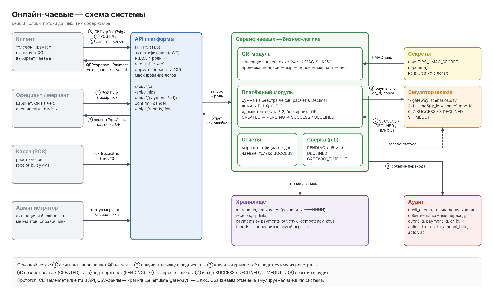
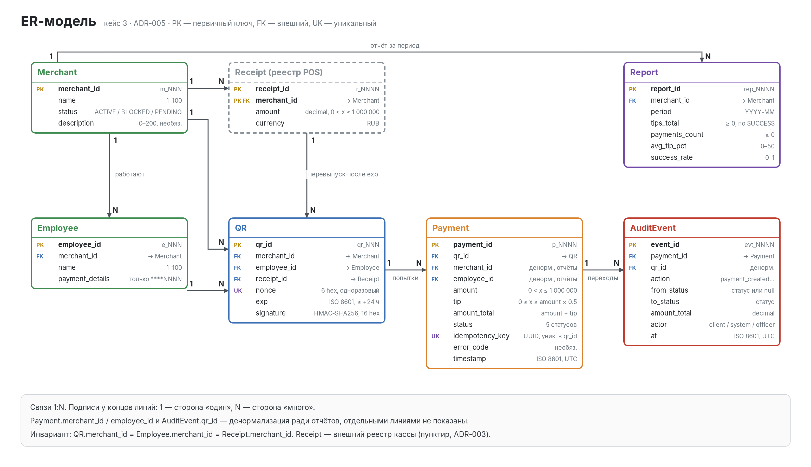
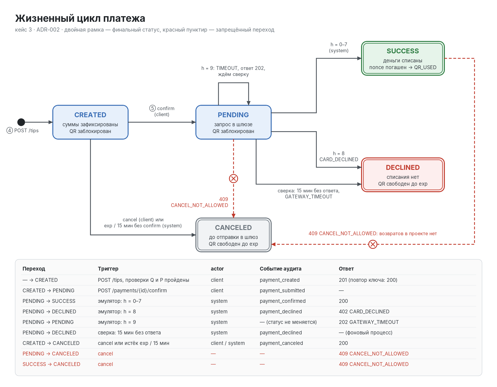
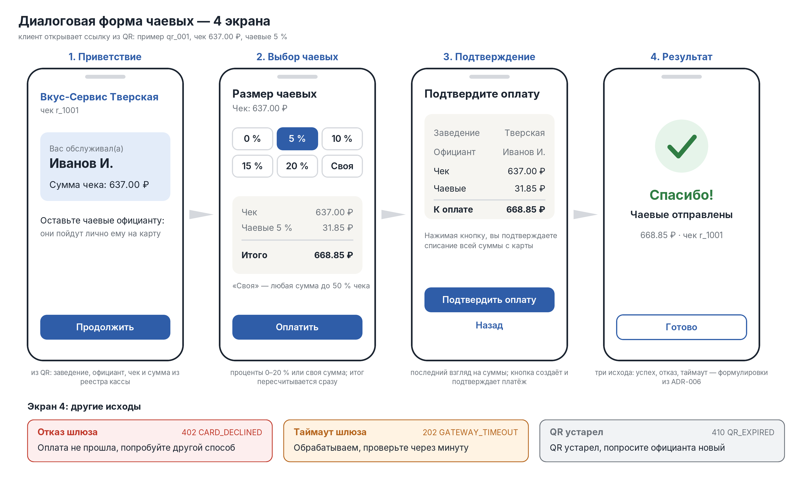

# Приложение к презентации — кейс 3 «Онлайн-чаевые»

**Команда:** [название] · **Состав:** [ФИО ×4] · **Чемпионат:** ВПОТОКЕ, этап 1

**Репозиторий:** https://github.com/AndrewStrizhevskiy/vpotoke-case3-tips

> Документ собран скриптом `docs/appendix/build_appendix.py` из исходных документов репозитория.
> Исправления вносим в исходники и пересобираем, а не правим этот файл руками.
> Места в [квадратных скобках] заполняет команда.

**Содержание:** A. Диаграммы (A.1–A.4) · B. Таблицы (B.1–B.4) · C. Журнал промптов ·
D. Матрица вклада · E. Артефакты · F. Чек-лист

## A. Диаграммы

### A.1. Схема системы



**Блоки**

| Блок | Что это | Что передаёт |
|-|-|-|
| Клиент | браузер на телефоне, без установки приложения | открывает ссылку `qr + sig`, выбирает чаевые, создаёт и подтверждает платёж с `idempotency_key` |
| Официант / мерчант | кабинет сотрудника заведения | запрос QR на чек (`receipt_id`), получает ссылку и картинку QR, смотрит свои чаевые и отчёты |
| Касса (POS) | кассовая система мерчанта | чек `{receipt_id, amount}` в реестр: источник суммы (ADR-003) |
| Администратор | оператор платформы | статус мерчанта (активация, блокировка), справочники |
| API платформы | единая точка входа | TLS, JWT, RBAC, rate limit, проверка формата; передаёт в сервис проверенный запрос и роль |
| Сервис чаевых | бизнес-логика из четырёх модулей | QR-модуль: генерация и проверка HMAC. Платёжный модуль: суммы, лимиты, идемпотентность, статусы. Отчёты. Сверка |
| Эмулятор шлюза | заменитель платёжного шлюза (ADR-001) | получает `{payment_id, qr_id, nonce, amount_total}`, возвращает SUCCESS / DECLINED / TIMEOUT |
| Секреты | переменные окружения | `TIPS_HMAC_SECRET` для QR-модуля, пароль БД |
| Хранилище | БД (в прототипе CSV) | merchants, employees, receipts, qr_links, payments, idempotency_keys, reports |
| Аудит | журнал, в который только дописывают | событие на каждый переход: `event_id, payment_id, qr_id, action, from_status, to_status, amount_total, actor, at` |

**Потоки данных**

| № | Откуда → куда | Данные | Результат |
|-|-|-|-|
| ① | Официант → API → QR-модуль | `POST /api/v1/qr {merchant_id, employee_id, receipt_id}` | проверки: мерчант ACTIVE, официант этого мерчанта, чек есть в реестре |
| ② | QR-модуль → официант | `https://tips.example/pay?qr=qr_001&sig=68d0f361ac38c12b` + картинка | запись в qr_links: nonce, exp ≤ 24 ч, signature |
| ③ | Клиент → API → QR-модуль | `GET /api/v1/qr/{id}?sig=` | QRResponse: имя официанта, сумма из реестра, варианты чаевых. Ошибки 422 / 410 / 409 / 403 |
| ④ | Клиент → платёжный модуль | `POST /api/v1/tips {qr_id, receipt_id, base_amount, tip_pct, idempotency_key}` | 201 Payment (CREATED) или 200 при повторе того же ключа |
| ⑤ | Клиент → платёжный модуль | `POST /api/v1/payments/{id}/confirm` или `/cancel` | CREATED → PENDING или CREATED → CANCELED |
| ⑥ | Платёжный модуль → эмулятор | `{payment_id, qr_id, nonce, amount_total}` | — |
| ⑦ | Эмулятор → платёжный модуль | SUCCESS / DECLINED (`CARD_DECLINED`) / TIMEOUT | статус в payments, ответ 200 / 402 / 202 |
| ⑧ | Сервис → аудит | событие перехода | одна запись на каждый переход, в одной транзакции с ним |
| — | Сверка → эмулятор | запрос статуса для PENDING | через 15 мин без ответа: DECLINED, `GATEWAY_TIMEOUT` |

### A.2. ER-модель



**Связи**

| Связь | Тип | Обоснование |
|-|-|-|
| Merchant → Employee | 1:N | в заведении несколько официантов, официант работает у одного мерчанта |
| Merchant → QR | 1:N | QR выпускаются на чеки заведения; связь хранится явно ради проверки при генерации |
| Employee → QR | 1:N | официант обслуживает много чеков |
| Receipt → QR | 1:N | после истечения `exp` на тот же чек можно выпустить новый QR |
| QR → Payment | 1:N | после DECLINED или CANCELED по тому же QR возможна новая попытка (ADR-002) |
| Merchant → Report | 1:N | один отчёт на мерчанта за каждый период |
| Payment → AuditEvent | 1:N | каждый переход статуса — отдельное событие |

Атрибуты всех 7 сущностей с типами и ограничениями — [A.2 полностью](../a2-er-model.md).

### A.3. Схема состояний платежа



- Двойная рамка — финальный статус: SUCCESS, DECLINED и CANCELED больше не меняются.
- Красный пунктир с ✕ — запрещённый переход, сервер отвечает 409 `CANCEL_NOT_ALLOWED`.
  Его рисуем намеренно: в шаблоне 07 строки PENDING → CANCELED и SUCCESS → CANCELED
  есть в матрице, и жюри должно увидеть, что они продуманы, а не забыты.
- Петля на PENDING — ответ эмулятора h = 9. Статус не меняется, клиент получает 202,
  событие аудита не пишется, потому что перехода нет.
- В PENDING ведут два выхода: отказ шлюза (h = 8) и сверка через 15 минут.
  Оба дают DECLINED, отличаются кодом: `CARD_DECLINED` или `GATEWAY_TIMEOUT`.

**Что происходит с QR**

| Статус платежа | QR |
|-|-|
| CREATED, PENDING | заблокирован: новая попытка получает 409 `PAYMENT_IN_PROGRESS` |
| SUCCESS | nonce погашен: дальше 409 `QR_USED` |
| DECLINED, CANCELED | свободен до `exp`, можно платить снова |

### A.4. Диалоговая форма и генерация QR



**Генерация QR и платёжной ссылки**

1. Мерчант или официант (на себя) запрашивает QR на чек: `POST /api/v1/qr {merchant_id, employee_id, receipt_id}`.
   В прототипе — команда `qr`; сумму чека в запросе присылает «касса» (поле `amount`).
2. Сервер проверяет условия (ниже) и создаёт `qr_id`, `nonce`, `exp`, вычисляет `signature`.
3. Записывает QR в `qr_links` (в прототипе — `qr_out.csv`) и новый чек в реестр (`receipts_out.csv`).
4. Формирует ссылку `https://tips.example/pay?qr={qr_id}&sig={signature}` и QR-код с ней.
5. Возвращает ссылку и картинку (в API — `qr_png_base64`; в прототипе — PNG-файл, если установлена утилита `qrencode`).

**Проверки при генерации:**

| Проверка | Если нарушена | Код |
|-|-|-|
| формат `m_NNN`, `e_NNN`, `r_NNNN`, сумма — число | не выпускать | VALIDATION_ERROR, 400 |
| мерчант существует и `status = ACTIVE` | не выпускать | NOT_FOUND, 404 / MERCHANT_BLOCKED, 403 |
| официант существует и принадлежит этому мерчанту | не выпускать | NOT_FOUND, 404 / ACCESS_DENIED, 403 |
| сумма чека в пределах `0 < x ≤ 1 000 000` | не выпускать | AMOUNT_OUT_OF_RANGE, 422 |
| `receipt_id` уникален для мерчанта: чек уже есть в реестре с другой суммой | не выпускать | AMOUNT_MISMATCH, 422 |
| на чек уже есть действующий QR | вернуть его, второй не выпускать | — (200, `new = false`) |
| действующий QR выпущен на другого официанта | не выпускать | ACCESS_DENIED, 403 |

После истечения `exp` на тот же чек можно выпустить новый QR (связь Receipt → QR — 1:N).

```bash
export TIPS_HMAC_SECRET=demo-secret-k3
echo '{"merchant_id":"m_001","employee_id":"e_001","receipt_id":"r_2001","amount":1250.50}' > qr.json
python3 prototype/04_прототип.py --now 2025-11-01T18:00:00Z qr qr.json
```

**Четыре экрана**

Макет собран из данных qr_001: заведение «Вкус-Сервис Тверская», официант Иванов И., чек r_1001 на 637.00 ₽, чаевые 5 %.
Пересборка: `python3 diagrams/build_dialog.py`, затем `convert -density 192 diagrams/dialog.svg diagrams/dialog.png`.

| Экран | Что показывает | Действие клиента | Вызов API |
|-|-|-|-|
| **1. Приветствие** | название заведения, имя официанта, номер и сумма чека | «Продолжить» | `GET /api/v1/qr/{qr_id}?sig=` → QRResponse |
| **2. Выбор чаевых** | кнопки 0 / 5 / 10 / 15 / 20 % и «Своя»; итог пересчитывается при выборе | выбирает процент или вводит сумму, «Оплатить» | — (расчёт на экране, сервер пересчитает) |
| **3. Подтверждение** | чек, чаевые, итог к оплате | «Подтвердить оплату» (или «Назад») | `POST /api/v1/tips`, затем `POST /payments/{id}/confirm` |
| **4. Результат** | итог оплаты, см. таблицу ниже | «Готово» | при таймауте — `GET /payments/{id}` |

Правила формы:
- «Своя» принимает любую сумму от 0 до 50 % чека; больше — `TIP_OUT_OF_RANGE`, поле подсвечивается.
- Ключ идемпотентности (`idempotency_key`) создаётся один раз при нажатии «Оплатить» и повторяется при ретраях;
  двойное нажатие на кнопку не создаёт второй платёж.
- Сумму чека форма берёт из ответа сервера и не даёт её менять.

**Экран 4, исходы** (тексты — [ADR-006](../adr-006-error-catalog.md)):

| Исход | HTTP / код | Текст | Что дальше |
|-|-|-|-|
| успех | 200, SUCCESS | «Спасибо! Чаевые отправлены» | конец |
| отказ шлюза | 402, CARD_DECLINED | «Оплата не прошла, попробуйте другой способ» | вернуться на экран 2 |
| таймаут шлюза | 202, GATEWAY_TIMEOUT | «Обрабатываем, проверьте через минуту» | опрос статуса; через 15 минут сверка закроет платёж |
| QR устарел | 410, QR_EXPIRED | «QR устарел, попросите официанта новый» | новый QR у официанта |
| прочие ошибки | 4xx | «Не удалось открыть оплату» | подробности только в логах |

Payload QR с объяснением полей и подпись — [документ полностью](../06-qr-and-dialog.md).

## B. Таблицы

### B.1. Правила QR и платежа

**Проверки QR**

| ID | Проверка | Действие при нарушении | Код ошибки / HTTP | Обоснование |
|---|---|---|---|---|
| Q-1 | `sig` из ссылки и подпись сохранённого payload совпадают с HMAC-SHA256 | Не открывать оплату, не создавать платёж | INVALID_QR / 422 | Нельзя доверять неподписанным данным; сравнение через `hmac.compare_digest` |
| Q-2 | `exp >= now` в UTC | Попросить новый QR | QR_EXPIRED / 410 | Ограничить время использования ссылки; равенство допустимо |
| Q-3 | nonce не погашен успешной оплатой | Запретить новую оплату | QR_USED / 409 | Не допустить повторного списания; DECLINED/CANCELED nonce не гасят |
| Q-4 | Мерчант ACTIVE | Запретить оплату для BLOCKED и PENDING | MERCHANT_BLOCKED / 403 | Неактивное заведение не принимает платежи |
| Q-5 | `receipt_id` запроса совпадает с QR и относится к тому же мерчанту | Не создавать платёж | RECEIPT_MISMATCH / 422 | QR привязан к конкретному чеку; реестр ведёт POS |
| Q-6 | `0 <= tip_pct <= 50` (целое) либо `0 <= tip_amount <= base_amount * 0.5` | Предложить исправить чаевые | TIP_OUT_OF_RANGE / 422 | Единый лимит для процентов и своей суммы; выполняется на этапе расчёта |

Payload подписи: `merchant_id|employee_id|receipt_id|nonce|exp`; signature — первые 16 hex HMAC-SHA256. Отсутствующий `sig` не раскрывает существование QR. TTL при выпуске — не больше 24 часов ([ADR-009](../adr-009-secrets-time-ttl.md)).

**Правила платежа**

| ID | Условие | Действие | Код ошибки / HTTP | Обоснование |
|---|---|---|---|---|
| P-1 | `base_amount <= 0` или `> 1 000 000` | Отклонить | AMOUNT_OUT_OF_RANGE / 422 | Допустимый диапазон суммы чека |
| P-2 | Повтор `(qr_id, idempotency_key)` | При том же каноническом теле вернуть тот же `payment_id` в текущем статусе без новой строки; при другом теле отклонить | — / 200; IDEMPOTENCY_CONFLICT / 409 | Сетевой повтор не должен создавать второй платёж; ключ UUID v4, хранение 24 ч, не дольше жизни QR. Проверяется сразу после Q-1, поэтому повтор после SUCCESS или истечения QR тоже получает свой платёж ([ADR-004](../adr-004-validation-order.md)) |
| P-3 | `amount_total > 2 000 000` | Отклонить | AMOUNT_OUT_OF_RANGE / 422 | Защита в глубину: при P-1 и Q-6 максимум 1 500 000, правило страхует будущие изменения лимитов |
| P-4 | Отмена не из CREATED | Запретить; из CREATED перейти в CANCELED; повторная отмена CANCELED → 200 | CANCEL_NOT_ALLOWED / 409 для PENDING, SUCCESS и DECLINED | После отправки в шлюз возможное списание нельзя отменять локально; закрытый платёж отменять нечего ([ADR-002](../adr-002-payment-lifecycle.md)) |

**Порядок выполнения**

1. Проверить формат, типы и обязательные поля (`VALIDATION_ERROR`, 400). В запросе ровно одно из `tip_pct` или `tip_amount`, иначе 400.
2. Выполнить Q-1, затем P-2: если есть платёж с тем же `(qr_id, idempotency_key)`, вернуть его (200) или `IDEMPOTENCY_CONFLICT` (409) при другом теле. Иначе Q-2 → Q-3 → Q-4 → Q-5. Первая ошибка останавливает обработку. P-2 стоит до Q-2 и Q-3, чтобы повтор после SUCCESS или истечения QR получил свой платёж, а не QR_USED или QR_EXPIRED ([ADR-004](../adr-004-validation-order.md)).
3. Сверить `base_amount` с Receipt.amount (`AMOUNT_MISMATCH`, 422), затем P-1 → Q-6 → P-3. Суммы считать в Decimal с ROUND_HALF_UP до 0.01: `tip = base * pct / 100`, `total = base + tip`.
4. Атомарно создать CREATED, ключ и блокировку QR. Другой ключ при CREATED/PENDING → `PAYMENT_IN_PROGRESS`, 409. Новый платёж — 201; новый ID после seed начинается с p_0101.
5. При confirm перевести CREATED → PENDING и вызвать эмулятор: таблица сценариев имеет приоритет над формулой ([ADR-001](../adr-001-gateway-emulator.md)). SUCCESS → 200; DECLINED/CARD_DECLINED → 402; таймаут → PENDING/GATEWAY_TIMEOUT, 202. Повторный confirm отвечает текущим статусом и прежним кодом без вызова шлюза; confirm отменённого платежа → `PAYMENT_STATE_CONFLICT`, 409 ([ADR-002](../adr-002-payment-lifecycle.md)).
6. P-4 выполняется отдельной операцией cancel. Автоотмена CREATED — при истечении QR или через 15 минут без confirm. Сверка после 15 минут без ответа закрывает PENDING в DECLINED/GATEWAY_TIMEOUT.
7. Каждый переход и событие аудита записывать вместе. nonce гасить только на SUCCESS; после DECLINED/CANCELED разрешить новую попытку до exp.

Контроль: 637.00 × 5 % = 31.85, итог 668.85; 911.00 × 15 % = 136.65, итог 1047.65; 53.50 × 5 % = 2.68. Исходные CSV не изменяются, новые строки идут только в `payments_out.csv`.

Порядок P-2 и ответы на повторные confirm и cancel были неоднозначны в ADR. Аналитик вынес это в первой версии документа, архитектор решил в ADR-002 и ADR-004 (PR #2).

### B.2. Матрица «ситуация → код ошибки → HTTP → retryable»

Первые четыре строки — образец из шаблона приложения, без изменений. Остальные строки
собраны по ADR-006. Каталога ошибок «из 08_errors.md», на который ссылается шаблон,
в материалах нет: в этом файле лежит ER-модель.

**retryable** — может ли повтор привести к успеху. В скобках сказано, что именно повторять.
**Правило** — ссылка на `02_правила.md` и ADR. **Тест** — какой сценарий проверяет строку.

**Проверка QR**

| Ситуация | Код ошибки | HTTP | retryable | Правило | Что видит клиент | Тест |
|-|-|-|-|-|-|-|
| Подпись QR не совпала | INVALID_QR | 422 | нет | Q-1 | «Не удалось открыть оплату» | T3-3 |
| QR истёк | QR_EXPIRED | 410 | да (новый QR) | Q-2 | «QR устарел, попросите официанта новый» | T3-3 (вариант) |
| nonce использован | QR_USED | 409 | нет | Q-3 | «Этот чек уже оплачен» | — |
| merchant BLOCKED | MERCHANT_BLOCKED | 403 | нет | Q-4 | «Оплата в заведении недоступна» | — |
| `receipt_id` не совпадает с QR | RECEIPT_MISMATCH | 422 | нет | Q-5 | «Не удалось открыть оплату» | — |

**Суммы**

| Ситуация | Код ошибки | HTTP | retryable | Правило | Что видит клиент | Тест |
|-|-|-|-|-|-|-|
| `base_amount` не совпадает с реестром чеков | AMOUNT_MISMATCH | 422 | нет | ADR-003 | «Сумма чека изменилась, обновите страницу» | — |
| `base_amount ≤ 0` или `> 1 000 000` | AMOUNT_OUT_OF_RANGE | 422 | нет | P-1 | «Некорректная сумма» | — |
| `tip_pct > 50` или своя сумма больше 50 % чека | TIP_OUT_OF_RANGE | 422 | да (исправить чаевые) | Q-6 | «Чаевые — не больше 50 % от чека» | — |
| `amount_total > 2 000 000` | AMOUNT_OUT_OF_RANGE | 422 | нет | P-3 | «Некорректная сумма» | — |

**Создание и жизненный цикл платежа**

| Ситуация | Код ошибки | HTTP | retryable | Правило | Что видит клиент | Тест |
|-|-|-|-|-|-|-|
| Тот же `idempotency_key`, то же тело (в том числе после SUCCESS или истечения QR) | — (вернуть существующий платёж) | 200 | — | P-2 | тот же экран, что после первого запроса | T3-4 |
| Тот же `idempotency_key`, другое тело | IDEMPOTENCY_CONFLICT | 409 | нет | P-2, ADR-008 | «Обновите страницу» | — |
| По QR уже есть платёж в CREATED или PENDING | PAYMENT_IN_PROGRESS | 409 | да (дождаться итога) | ADR-002 | «Оплата уже обрабатывается» | — |
| Отмена из CREATED | — | 200, CANCELED | — | ADR-002 | «Оплата отменена» | T3-5 |
| Отмена из PENDING | CANCEL_NOT_ALLOWED | 409 | нет | P-4 | «Оплата уже отправлена в банк» | T3-5 |
| Отмена из SUCCESS | CANCEL_NOT_ALLOWED | 409 | нет | P-4 | «Оплата уже прошла» | — |
| Отмена из DECLINED | CANCEL_NOT_ALLOWED | 409 | нет | P-4 | «Оплата не прошла, отменять нечего» | — |
| Повторная отмена CANCELED | — | 200, CANCELED | — | ADR-002 | «Оплата отменена» | — |
| Повторный confirm (PENDING / SUCCESS / DECLINED) | — (текущий статус, шлюз не вызывается) | 202 / 200 / 402 | — | ADR-002, ADR-008 | тот же экран, что после первого confirm | — |
| confirm для CANCELED | PAYMENT_STATE_CONFLICT | 409 | нет | ADR-002 | «Оплата была отменена» | — |

**Платёжный шлюз**

| Ситуация | Код ошибки | HTTP | retryable | Правило | Что видит клиент | Тест |
|-|-|-|-|-|-|-|
| Эмулятор вернул 0–7 | — | 200, SUCCESS | — | ADR-001 | «Спасибо! Чаевые отправлены» | T3-1 |
| Эмулятор вернул 8 | CARD_DECLINED | 402 | да (другой способ оплаты) | ADR-001 | «Оплата не прошла, попробуйте другой способ» | T3-2 |
| Эмулятор вернул 9 | GATEWAY_TIMEOUT | 202, PENDING | да (опросить статус) | ADR-001 | «Обрабатываем, проверьте через минуту» | T3-6 (доп., qr_010) |
| Сверка: 15 мин без ответа | GATEWAY_TIMEOUT | — (статус DECLINED) | да (новая попытка) | ADR-002 | «Оплата не прошла, деньги не списаны» | T3-6 (доп.) |

**Запрос и доступ**

| Ситуация | Код ошибки | HTTP | retryable | Правило | Что видит клиент | Тест |
|-|-|-|-|-|-|-|
| Неверный формат запроса | VALIDATION_ERROR | 400 | нет | ADR-004, шаг 1 | «Не удалось открыть оплату» | — |
| QR или платёж не найден (подпись верна) | NOT_FOUND | 404 | нет | — | «Не удалось открыть оплату» | — |
| Нет прав, например чужой отчёт | ACCESS_DENIED | 403 | нет | RBAC, 11_ИБ | «Нет доступа» (кабинет) | — |
| Превышен rate limit | RATE_LIMITED | 429 | да (после `Retry-After`) | ADR-009 | «Слишком много попыток, подождите» | — |

**Принципы**

1. **Клиенту — общий текст, в логи — точная причина.** Для INVALID_QR, RECEIPT_MISMATCH, NOT_FOUND
   и VALIDATION_ERROR текст один и тот же: перебирающий QR не должен понимать, что именно не так.
2. **Порядок проверок фиксирован** (ADR-004): у неподписанного QR всегда 422, а не 410.
   Иначе ответ раскрывал бы срок жизни QR, о котором атакующий знать не должен.
   Повтор с тем же ключом ищется сразу после подписи, поэтому он не получает `QR_USED` или `QR_EXPIRED`.
3. **У каждой ситуации один код.** Повторные confirm и cancel отвечают как первый вызов;
   `PAYMENT_STATE_CONFLICT` — только confirm отменённого платежа (ADR-002).
4. **Деньги не теряются ни при одной ошибке:** отказ и таймаут заканчиваются DECLINED без списания,
   отменить можно только платёж, который не дошёл до шлюза.
5. **Формат ответа единый:** `{error_code, message, retryable, details}`, схема Error
   в `api/05_api_schemas.yaml`. В `details` не попадают секреты и реквизиты.

### B.3. Тесты

Прогон: `export TIPS_HMAC_SECRET=<демо-ключ из README> && python3 prototype/run_tests.py`.
Все запуски с `--now 2025-11-01T18:00:00Z`, если не сказано иное. Результат: 16 из 16.

| Тест | Вход | Ожидание | Факт | Пройден |
|-|-|-|-|-|
| T3-1 Успех | qr_001, 637.00, 5 % | SUCCESS, tip 31.85, total 668.85, выход 0 | выход 0, SUCCESS, tip 31.85, total 668.85 | да |
| T3-2 Отказ | qr_003, 911.00, 15 % | DECLINED, CARD_DECLINED, tip 136.65, total 1047.65 | выход 1, DECLINED, CARD_DECLINED, tip 136.65, total 1047.65 | да |
| T3-3 Неверный QR | qr_001, испорченный `sig` | INVALID_QR, выход 2, строки нет | выход 2, INVALID_QR, строк в payments_out.csv: 0 | да |
| T3-3б Истёк | qr_001, `--now 2025-11-02T00:00:00Z` | QR_EXPIRED | выход 2, QR_EXPIRED, строк: 0 | да |
| T3-3в Чужой чек | qr_004, `receipt_id` r_9999 | RECEIPT_MISMATCH, выход 2, строки нет | выход 2, RECEIPT_MISMATCH, строк: 0 | да |
| T3-4 Повтор | один `idempotency_key` дважды | тот же `payment_id`, одна строка | p_0101 и p_0101, строк: 1 | да |
| T3-4б Повтор после оплаты | qr_001 после T3-1, тот же `idempotency_key` | 200, тот же `payment_id`, не QR_USED | выход 0, SUCCESS, p_0101, строк: 1 | да |
| T3-5 Отмена | `create` → `cancel`; qr_010 в PENDING → `cancel` | CANCELED; CANCEL_NOT_ALLOWED | CREATED → CANCELED; из PENDING: CANCEL_NOT_ALLOWED | да |
| T3-5б Повторные действия | повторный `confirm` после SUCCESS; `confirm` после `cancel`; повторный `cancel` | 200 без вызова шлюза; PAYMENT_STATE_CONFLICT; 200 CANCELED | confirm после SUCCESS: SUCCESS, новых событий аудита нет; confirm после cancel: PAYMENT_STATE_CONFLICT; повторный cancel: CANCELED | да |
| T3-6 Таймаут | qr_010 | PENDING, GATEWAY_TIMEOUT | выход 1, PENDING, GATEWAY_TIMEOUT | да |
| T3-7 Блокировка | QR m_019 (`test_qr_links.csv`) | MERCHANT_BLOCKED | выход 2, MERCHANT_BLOCKED, строк: 0 | да |
| T3-8 Чаевые > 50 % | qr_001, `tip_pct` 51 | TIP_OUT_OF_RANGE | выход 2, TIP_OUT_OF_RANGE | да |
| T3-9 Повторная оплата | qr_001 после T3-1, другой ключ | QR_USED | выход 2, QR_USED, строк: 1 | да |
| T3-10 Выпуск QR | `qr` для m_001 / e_001 / чек r_2001 на 1250.50; повтор; платёж по ссылке; платёж с другой суммой | QR выпущен, повтор возвращает тот же; CREATED, итог 1375.55; AMOUNT_MISMATCH | qr_101 новый, повтор: qr_101 (new=False); платёж CREATED, итог 1375.55; другая сумма: AMOUNT_MISMATCH | да |
| T3-11 Проверки выпуска QR | заблокированный мерчант m_019; официант другого мерчанта; чек r_1001 с другой суммой; неверный формат | MERCHANT_BLOCKED, ACCESS_DENIED, AMOUNT_MISMATCH, VALIDATION_ERROR; QR не выпущен | MERCHANT_BLOCKED, ACCESS_DENIED, AMOUNT_MISMATCH, VALIDATION_ERROR; QR не выпущен | да |
| T3-12 Отчёты | `report` по m_001, e_001, по дням, пустой период, период из двух месяцев | 414.85 / 6 / 9.0 / 0.83; 83.6 / 2 / 41.8 / 2025-11-03; 2 дня; нули; VALIDATION_ERROR | m_001: 414.85 / 6 / 9.0 / 0.83; e_001: 83.6 / 2 / 41.8 / 2025-11-03; по дням: 2; пустой период: 0 | да |

**Ограничения прототипа**

- Статус платежа и событие аудита пишутся двумя отдельными записями (`payments_out.csv`, затем
  `audit_out.csv`). При обрыве между ними статус сменится без события. В реальной системе обе записи
  идут в одной транзакции БД (ADR-004, шаг 8).

### B.4. Архитектурные решения (ADR)

Черновики архитектора от 2026-11-02. Каждый ADR закрывает противоречие в материалах кейса
или пробел в них. Перед сдачей команда перерабатывает тексты и записывает итерации в журнал промптов.

| ADR | Решение | Куда идёт |
|-|-|-|
| [001](../adr-001-gateway-emulator.md) | Эмулятор: таблица сценариев + формула организаторов | 07, слайд 4, тесты T3-1/T3-2 |
| [002](../adr-002-payment-lifecycle.md) | Состояния, переходы, отмена только из CREATED, nonce гасится на SUCCESS | 07, A.3, T3-5 |
| [003](../adr-003-trust-boundary.md) | Сумма чека из реестра, подпись в ссылке | A.1, 11_ИБ (U-5), слайд 5 |
| [004](../adr-004-validation-order.md) | 8 шагов проверок, лимиты, Decimal | 02_правила, B.1, слайд 4 |
| [005](../adr-005-data-model.md) | ER и CSV, денормализация, Receipt | 08 (ER), A.2, 03_data_dictionary |
| [006](../adr-006-error-catalog.md) | Каталог ошибок и экраны клиента | B.2, 05_api_schemas, 06 (экран 4) |
| [007](../adr-007-reporting.md) | Метрики отчётов и контрольные значения | 09_reports |
| [008](../adr-008-idempotency.md) | Идемпотентность и атомарность | 02_правила (P-2), T3-4 |
| [009](../adr-009-secrets-time-ttl.md) | Секреты, UTC, `--now`, TTL, rate limit, маскирование логов | 11_ИБ, 04_requirements (NFR) |

## C. Журнал промптов

Правила чемпионата: ИИ — ассистент, а не автор. Записываем каждую итерацию: дата, цель,
запрос (сжато), результат, как проверили, использовано (да / нет / переработано).
Каждый участник добавляет свои строки. «Использовано» ставим только после того, как сами
переработали результат и можем его объяснить.

Строки 1–10 — работа архитектора с Claude Code 2026-11-02. Колонка «Использовано» пока
«черновик»: архитектор меняет её после переработки.

| # | Дата | Кто | Цель | Промпт (сжато) | Результат | Проверка | Использовано |
|-|-|-|-|-|-|-|-|
| 1 | 2026-11-02 | архитектор | Понять задачу архитектора | «я архитектор, помоги» + все материалы кейса | список артефактов архитектора и 10 противоречий в материалах | каждое противоречие сверено с исходными файлами вручную | черновик |
| 2 | 2026-11-02 | архитектор | Проверить данные | загрузка 4 CSV | 100/100 подписей HMAC сходятся; формула эмулятора противоречит T3-1/T3-2; статусы seed совпадают с эмулятором в 59/100 | скрипт пересчёта подписей и h; qr_001 и qr_003 пересчитаны отдельно | черновик |
| 3 | 2026-11-02 | архитектор | Решить конфликт эмулятора | «своё правило» | ADR-001: таблица сценариев + формула организаторов | скрипт: qr_001 → SUCCESS, qr_003 → DECLINED, распределение 83/12/5 | черновик |
| 4 | 2026-11-02 | архитектор | Закрыть остальные противоречия | «остальные ADR» | ADR-002…009 | контрольные цифры пересчитаны по CSV (m_001: 414.85 / 6 / 0.83; e_001: 83.60); пример ошибки округления float проверен | черновик |
| 5 | 2026-11-02 | архитектор | Схема системы A.1 | «схема системы» | system.png/.svg/.drawio, таблица блоков и потоков | PNG просмотрен, наложения исправлены; генератор проверяет переполнение текста | черновик |
| 6 | 2026-11-02 | архитектор | Схема состояний A.3 | «схема состояний» | states.png/.svg/.drawio, таблица переходов | PNG просмотрен; переходы сверены с ADR-002 и тестом T3-5 | черновик |
| 7 | 2026-11-02 | архитектор | ER-модель A.2 | «ER-модель» | er.png/.svg/.drawio, заполненный шаблон 08 | связь p_000N ↔ qr_00N проверена на 100 записях; уникальность receipt_id в пределах мерчанта проверена | черновик |
| 8 | 2026-11-02 | архитектор | OpenAPI | «заполнить 05_api» | api/05_api_schemas.yaml | openapi-spec-validator; примеры проверены по схемам; 4 неверных TipCreate отклоняются | черновик |
| 9 | 2026-11-02 | архитектор | Шаблоны 11_ИБ, 07, матрица B.2 | «заполнить 11_ИБ», «заполнить 07», «матрица ошибок B.2» | docs/11-security.md, 07-payment-emulator.md, b2-error-matrix.md | коды ошибок сверены скриптом между B.2, ADR-006 и API; подписи и h в примерах пересчитаны | черновик |
| 10 | 2026-11-02 | архитектор | Слайды 3–5 | «слайды 3–5» | черновик слайдов с заметками докладчика | просмотрены архитектором; текст требует переработки презентатором | черновик |
| 11 | 2026-11-02 | разработчик | Доработать прототип по ADR | «делай задание разработчика» + руководство и ADR-001…009 | 04_прототип.py (create/confirm/cancel/reconcile, Decimal, идемпотентность, аудит), run_tests.py, test_qr_links.csv, docs/03-tests.md | run_tests.py: 10 из 10; md5sum seed без изменений; в prototype/ нет секрета; reconcile и audit прогнаны вручную | черновик |


### Работа аналитика с Codex — 2026-11-02

Ниже записан результат работы ИИ-ассистента по запросу участника. Автоматическая сверка не заменяет командную вычитку, самостоятельную переработку и умение объяснить решения на защите. Статус «черновик» оставлен до проверки участником; сдача от его имени не утверждается.

| # | Дата | Кто | Цель | Промпт (сжато) | Результат | Проверка | Использовано |
|-|-|-|-|-|-|-|-|
| 12 | 2026-11-02 | участник / Codex | Подготовить среду | «Используйте cloud-environment-onboarding:setup» | .venv с Pillow, OpenAPI validator и CairoSVG; install_script/start_skill сохранены в черновик среды | pip check, OpenAPI и MD5 прошли; CLI запущен изолированно: qr_001 UNKNOWN, qr_003 SUCCESS — подтверждены дефекты прототипа; для схем отсутствует Inter, fallback даёт переполнение | настройка среды проверена, публикация пользователем ещё требуется |
| 13 | 2026-11-02 | аналитик / Codex | Заполнить всю работу аналитика и сохранить на GitHub по правилам | «реализовать всю работу аналитика и сохранить изменения на гитхабе согласно правилам» | docs/02-rules, 02-roles, 03-data-dictionary, 04-requirements, 09-reports; проверка docs/checks/analyst_data.py; ссылки и статус в README | 22 колонки; FK и связи 100 Payment ↔ QR; маски 60 сотрудников; матрица 8 × 4 дословно совпала с 11-security; 3 JSON ответа совпали с расчётами и схемами OpenAPI; все локальные ссылки существуют; git diff --check и MD5 прошли | черновик для командной вычитки |
| 14 | 2026-11-02 | аналитик / Codex | Независимо пересчитать отчёты и обозначить пробелы контракта | Сверка требований с ADR/API/CSV в рамках запроса № 13 | m_001: 414.85 / 6 / 9.00 / 0.83; e_001: 83.60 / 2 / 41.80 / 2025-11-03; дневные: 245.90 / 3 / 10.00 и 168.95 / 3 / 7.50; неоднозначности Q-3/P-2, повторного confirm/cancel и граничных случаев отчётности вынесены явно | Python csv + Decimal ROUND_HALF_UP, исходные CSV не менялись; предложения по пустому периоду/равенству top_day отделены от принятых ADR; тесты реализации не объявлены пройденными | черновик, открытые вопросы — архитектору |
| 15 | 2026-11-03 | архитектор / Claude | Довести PR #1 аналитика по ревью | «поправь сам» (аналитик не ответил на ревью) | влит main, строки журнала 12–14; 02-rules и 04-requirements по ADR-002/004 из PR #2; FR-3 0–20 %; receipt_id обязателен; устаревшие заметки о прототипе; analyst_data.py: Python < 3.11, check() вместо assert, null и ранний top_day | analyst_data.py проходит и с -O; check(False) прерывает прогон; run_tests.py 13 из 13 | черновик, аналитику — вычитать |
| 16 | 2026-11-03 | архитектор / Claude | Закрыть пробелы кейса: диалоговая форма, генерация QR, отчёты в прототипе | «начни» после анализа проекта | docs/06-qr-and-dialog.md, diagrams/dialog (макет 4 экранов), команды `qr` и `report` в 04_прототип.py, тесты T3-10…T3-12, граничные случаи отчётов в ADR-007 | run_tests.py 16 из 16; отчёты сверены с ADR-007 и analyst_data.py (414.85 / 6 / 9.0 / 0.83); ручные проверки ошибок выпуска QR; PNG макета просмотрен; seed md5 без изменений | черновик, разработчику — вычитать изменения в прототипе |

## D. Матрица вклада

| Участник | Роль | Файлы / задачи | Часы | Подпись |
|-|-|-|-|-|
| [ФИО] | Архитектор | ADR-001…009, схемы A.1–A.4, диалоговая форма и генерация QR (06), API (05), шаблоны 07 и 11_ИБ, матрица B.2, слайды 3–5, ревью PR | [ч] | |
| [ФИО] | Аналитик | 02-rules, 02-roles, 03-data-dictionary, 04-requirements, 09-reports, скрипт проверки данных | [ч] | |
| [ФИО] | Разработчик | прототип `04_прототип.py` (платёж, `qr`, `report`), `run_tests.py` (16 тестов), 03-tests | [ч] | |
| [ФИО] | Презентатор | слайды 1, 2, 6–8, сборка приложения, экспорт в PDF, защита | [ч] | |

Часы и подписи каждый заполняет сам. Задачи у всех четырёх разные.

## E. Артефакты

| Артефакт | Где взять | Статус |
|-|-|-|
| Ссылка на Git-ветку `team_N_case_3` | создать ветку от `main`, когда будет номер команды | [ ] |
| Скриншот последнего коммита | `git log -1` или страница коммита на GitHub | [ ] |
| Скриншот прототипа: qr_001 и qr_003 | `export TIPS_HMAC_SECRET=demo-secret-k3`, затем `python3 prototype/run_tests.py` | [ ] |
| Скриншот `md5sum`: данные не менялись | `cd prototype/01_данные && md5sum -c MD5SUMS` | [ ] |

[Скриншоты вставить сюда.]

Репозиторий сейчас приватный: перед сдачей открыть доступ жюри или сделать публичным (https://github.com/AndrewStrizhevskiy/vpotoke-case3-tips).

## F. Чек-лист приложения

- [x] Схема системы: 5–6 блоков, потоки подписаны — A.1
- [x] Схема состояний платежа — A.3
- [x] Диалоговая форма (4 экрана) и генерация QR — A.4
- [x] ER-модель — A.2
- [x] Правила Q-1…Q-6, P-1…P-4 с обоснованием — B.1
- [x] Матрица «ситуация → код → HTTP → retryable» — B.2
- [x] Тесты T3-1…T3-5 с фактом — B.3 (16 тестов, все пройдены)
- [x] Журнал промптов: 5+ строк — C
- [ ] Матрица вклада: 4 человека, задачи разные — D, заполнить ФИО и часы
- [ ] Git-ветка и коммит — E
- [ ] Экспорт в PDF до защиты
