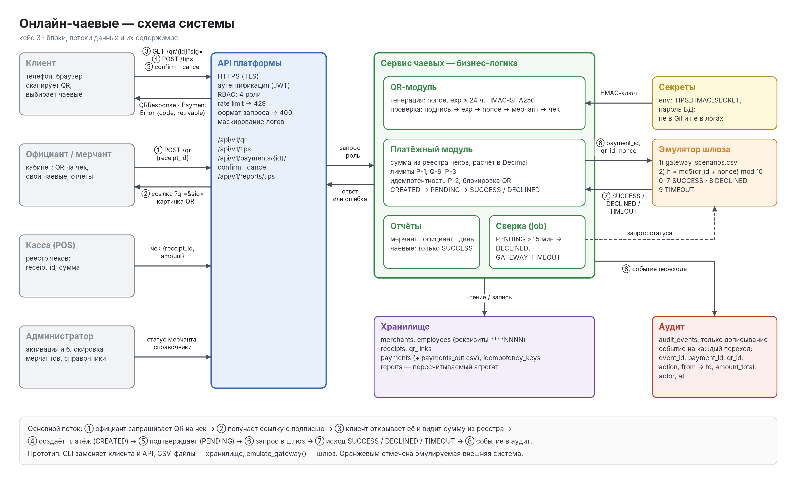
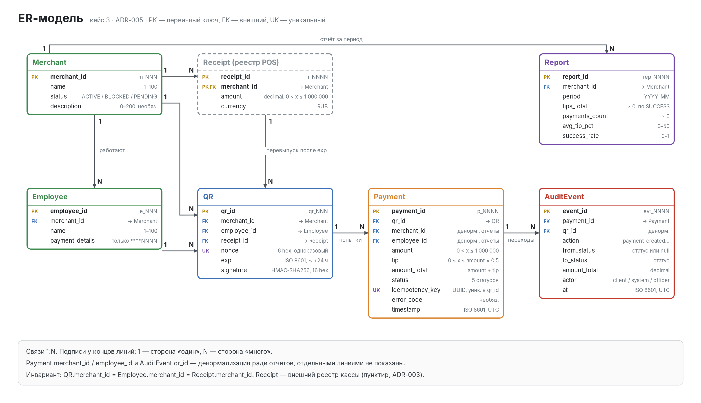
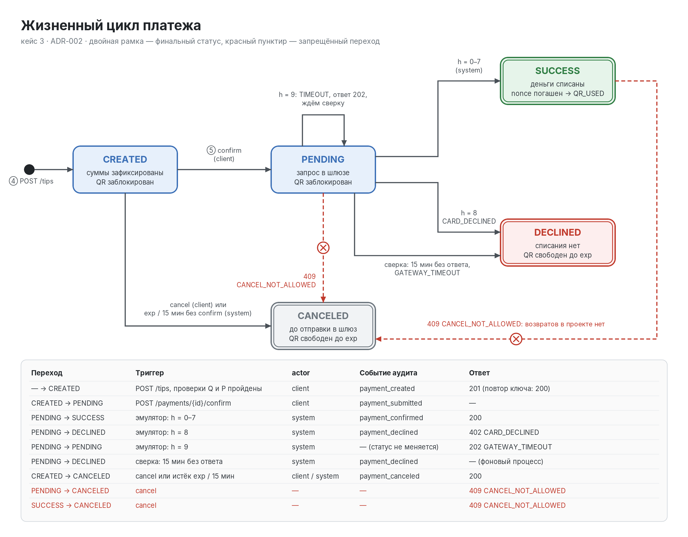
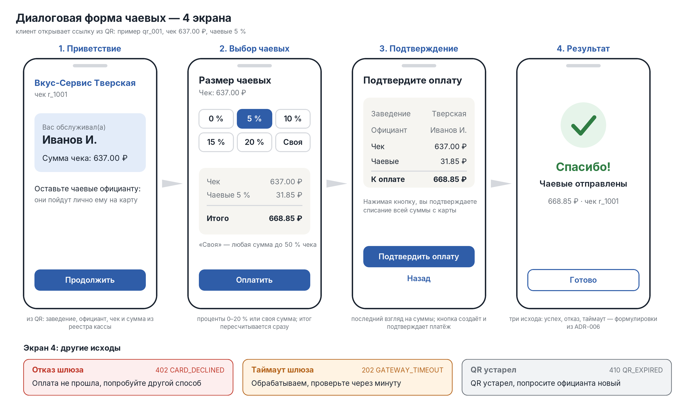
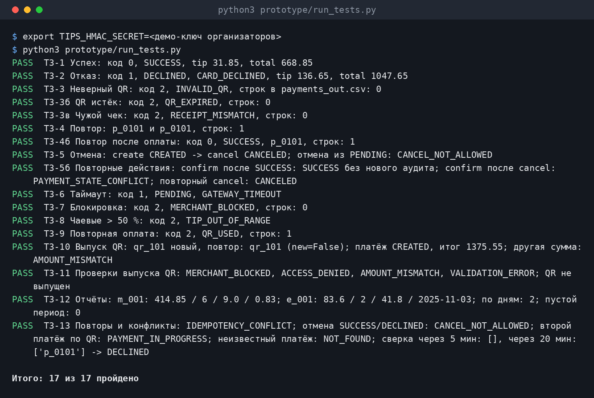
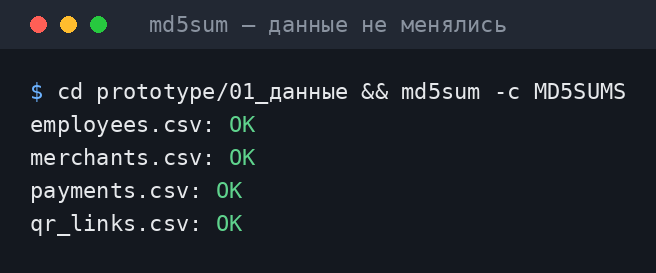
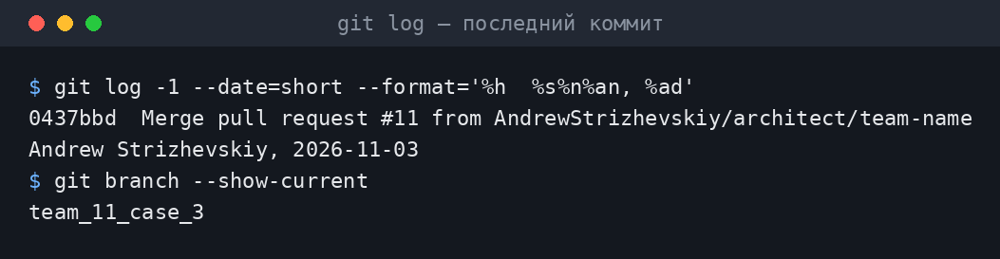
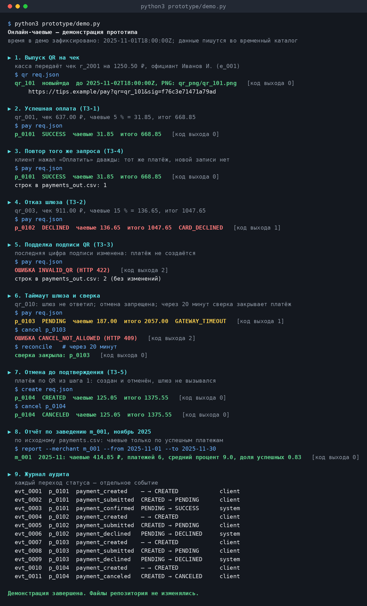

# Приложение к презентации

Кейс 3 «Онлайн-чаевые» для сети «Вкус-Сервис»

Платформа связывает чаевые с рестораном, сотрудником и чеком. Приложение описывает архитектуру, данные, QR, диалог оплаты, правила, тесты и артефакты. Консольный прототип моделирует платёжный процесс без реальных списаний.

| Участник | Роль |
| --- | --- |
| Левенко Богдан | Презентатор |
| Верховых Егор | Разработчик |
| Стрижевский Андрей | Архитектор |
| Парамонов Данил | Аналитик |

Команда № 11 «Los Pollos Hermanos». Дата подготовки: 03.11.2026.

Репозиторий: https://github.com/AndrewStrizhevskiy/vpotoke-case3-tips
Итоговая ветка сдачи: `team_11_case_3` (https://github.com/AndrewStrizhevskiy/vpotoke-case3-tips/tree/team_11_case_3). Все изменения вносились через pull request.

Реализовано: выпуск QR и платёжной ссылки, проверки, расчёт чаевых, создание и подтверждение платежа, отмена и сверка, защита от последовательных повторов, CSV-аудит и отчёты CLI. Свежий прогон: 16 из 16 тестов.

Целевые компоненты: браузерный интерфейс по макету, регистрация, JWT/RBAC, ограничения частоты запросов, транзакционная БД, кассовые и банковские интеграции. Эти компоненты не следует считать готовыми возможностями CLI.

# A.1 Архитектура системы

| Блок | Назначение |
| --- | --- |
| Гость / заведение | Открытие ссылки, выбор чаевых, запрос QR и отчётов |
| API и сервис | Валидация, расчёты, состояния и управление доступом в целевой системе |
| Касса | Доверенные сведения о чеке и его сумме |
| Эмулятор | SUCCESS, DECLINED или TIMEOUT вместо банка |
| Хранилище / аудит | Справочники, чеки, QR, платежи и события |

В CLI API и браузер заменяют команды, БД — CSV. qr сохраняет новые чеки и ссылки, report рассчитывает агрегаты. Платёж и аудит записываются отдельно; в целевой БД нужна одна транзакция. Источник: docs/a1-system-diagram.md, код прототипа.

# A.2 Модель данных

| Сущность / связь | Ключи и ограничения |
| --- | --- |
| Merchant 1:N Employee | merchant_id PK/FK, employee_id PK; сотрудник принадлежит ресторану |
| Receipt 1:N QR | Чек уникален по паре restaurant/receipt; допускается перевыпуск QR после истечения |
| QR 1:N Payment | qr_id PK/FK; разные попытки, максимум один успешный платёж на QR |
| Report / AuditEvent | Агрегаты по Payment; Payment 1:N события переходов |

Seed-CSV не меняются. Новые записи: qr_out.csv, receipts_out.csv, payments_out.csv и audit_out.csv. Имена и названия не уникальны. Report рассчитывается из Payment. Источник: ADR-005, docs/a2-er-model.md.

# A.3 Состояния платежа

| Переход | Событие |
| --- | --- |
| CREATED → PENDING | Подтверждение, отправка в шлюз |
| PENDING → SUCCESS / DECLINED | Окончательный ответ эмулятора |
| CREATED → CANCELED | Отмена до отправки либо автоотмена |
| TIMEOUT → PENDING | Окончательного ответа нет, требуется сверка |
| PENDING → DECLINED при сверке | Учебное правило: 15 минут без ответа |
| Повторные действия | Повтор confirm возвращает текущий статус; повтор cancel для CANCELED допустим |

Отмена из PENDING запрещена: возможное списание нельзя отменять сменой локального статуса. nonce гасится только после SUCCESS. После отказа или отмены новая попытка разрешена до exp. Источник: ADR-002.

# A.4 Диалоговая форма и выпуск QR

| Экран | Содержание / действие |
| --- | --- |
| Приветствие | Заведение, официант, чек и сумма из реестра |
| Выбор чаевых | 0 / 5 / 10 / 15 / 20 % либо своя сумма до 50 % |
| Подтверждение | Чек + чаевые = итог; создание и подтверждение платежа |
| Результат | Успех, отказ, ожидание либо ошибка QR |

Команда qr принимает ресторан, сотрудника, чек и сумму от кассы. Проверяет принадлежность сотрудника, ACTIVE-статус, сумму и существующий QR. Создаёт nonce, exp до 24 ч, HMAC-SHA256 и ссылку. Повтор на действующий QR возвращает прежнюю ссылку. PNG формируется при наличии qrencode; в этой среде проверена ссылка, без PNG.

Сумма в подпись не входит: сервер сверяет её с реестром. Включение суммы в payload v2 — план. Макет показывает целевой интерфейс, браузерная форма в CLI не реализована. Источник: docs/06-qr-and-dialog.md; T3-10/T3-11.

# B.1 Правила QR и платежа

| ID | Условие / действие | Обоснование |
| --- | --- | --- |
| Q-1 | sig из ссылки и подпись сохранённого payload совпадают с HMAC-SHA256; Не открывать оплату, не создавать платёж; INVALID_QR / 422 | Нельзя доверять неподписанным данным; сравнение через hmac.compare_digest |
| Q-2 | exp >= now в UTC; Попросить новый QR; QR_EXPIRED / 410 | Ограничить время использования ссылки; равенство допустимо |
| Q-3 | nonce не погашен успешной оплатой; Запретить новую оплату; QR_USED / 409 | Не допустить повторного списания; DECLINED/CANCELED nonce не гасят |
| Q-4 | Мерчант ACTIVE; Запретить оплату для BLOCKED и PENDING; MERCHANT_BLOCKED / 403 | Неактивное заведение не принимает платежи |
| Q-5 | receipt_id запроса совпадает с QR и относится к тому же мерчанту; Не создавать платёж; RECEIPT_MISMATCH / 422 | QR привязан к конкретному чеку; реестр ведёт POS |
| Q-6 | 0 <= tip_pct <= 50 (целое) либо 0 <= tip_amount <= base_amount * 0.5; Предложить исправить чаевые; TIP_OUT_OF_RANGE / 422 | Единый лимит для процентов и своей суммы; выполняется на этапе расчёта |
| P-1 | base_amount <= 0 или > 1 000 000; Отклонить; AMOUNT_OUT_OF_RANGE / 422 | Допустимый диапазон суммы чека |
| P-2 | Повтор (qr_id, idempotency_key); При том же каноническом теле вернуть тот же payment_id в текущем статусе без новой строки; при другом теле отклонить; — / 200; IDEMPOTENCY_CONFLICT / 409 | Сетевой повтор не должен создавать второй платёж; ключ UUID v4, хранение 24 ч, не дольше жизни QR. Проверяется сразу после Q-1, поэтому повтор после SUCCESS или истечения QR тоже получает свой платёж (ADR-004) |
| P-3 | amount_total > 2 000 000; Отклонить; AMOUNT_OUT_OF_RANGE / 422 | Защита в глубину: при P-1 и Q-6 максимум 1 500 000, правило страхует будущие изменения лимитов |
| P-4 | Отмена не из CREATED; Запретить; из CREATED перейти в CANCELED; повторная отмена CANCELED → 200; CANCEL_NOT_ALLOWED / 409 для PENDING, SUCCESS и DECLINED | После отправки в шлюз возможное списание нельзя отменять локально; закрытый платёж отменять нечего (ADR-002) |

Порядок: формат → подпись → поиск повтора → срок/nonce/статус/чек → сверка суммы и лимиты → CREATED → подтверждение → результат и аудит. Повтор проверяется до exp и nonce, чтобы после успеха возвращать прежний платёж.

Decimal и ROUND_HALF_UP до 0,01: 637 × 5 % = 31,85 ₽; итог 668,85 ₽. 53,50 × 5 % = 2,68 ₽. P-3 — запасной лимит для будущих изменений. Источники: docs/02-rules.md, ADR-004/008.

# B.2 Ошибки QR и расчётов

| Ситуация | Код | HTTP | Повтор |
| --- | --- | --- | --- |
| Подпись QR не совпала | INVALID_QR | 422 | нет |
| QR истёк | QR_EXPIRED | 410 | да (новый QR) |
| nonce использован | QR_USED | 409 | нет |
| merchant BLOCKED | MERCHANT_BLOCKED | 403 | нет |
| receipt_id не совпадает с QR | RECEIPT_MISMATCH | 422 | нет |
| base_amount не совпадает с реестром чеков | AMOUNT_MISMATCH | 422 | нет |
| base_amount ≤ 0 или > 1 000 000 | AMOUNT_OUT_OF_RANGE | 422 | нет |
| tip_pct > 50 или своя сумма больше 50 % чека | TIP_OUT_OF_RANGE | 422 | да (исправить чаевые) |
| amount_total > 2 000 000 | AMOUNT_OUT_OF_RANGE | 422 | нет |

Проверки при выпуске QR

| Условие | Ответ |
| --- | --- |
| Ресторан неактивен / чужой сотрудник | MERCHANT_BLOCKED / ACCESS_DENIED |
| Неверная сумма существующего чека | AMOUNT_MISMATCH |
| Формат запроса неверен | VALIDATION_ERROR |
| Действующий QR уже есть | Тот же qr_id, new = false |

Ошибки проверки не создают платёж. Подпись проверяется первой, чтобы не раскрывать неподтверждённые сведения. Источники: docs/b2-error-matrix.md, docs/06-qr-and-dialog.md.

# B.2 Ошибки состояний и доступа

| Ситуация | Код / результат | HTTP | Повтор |
| --- | --- | --- | --- |
| Тот же idempotency_key, то же тело (в том числе после SUCCESS или истечения QR) | — (вернуть существующий платёж) | 200 | — |
| Тот же idempotency_key, другое тело | IDEMPOTENCY_CONFLICT | 409 | нет |
| По QR уже есть платёж в CREATED или PENDING | PAYMENT_IN_PROGRESS | 409 | да (дождаться итога) |
| Отмена из CREATED | — | 200, CANCELED | — |
| Отмена из PENDING | CANCEL_NOT_ALLOWED | 409 | нет |
| Отмена из SUCCESS | CANCEL_NOT_ALLOWED | 409 | нет |
| Отмена из DECLINED | CANCEL_NOT_ALLOWED | 409 | нет |
| Повторная отмена CANCELED | — | 200, CANCELED | — |
| Повторный confirm (PENDING / SUCCESS / DECLINED) | — (текущий статус, шлюз не вызывается) | 202 / 200 / 402 | — |
| confirm для CANCELED | PAYMENT_STATE_CONFLICT | 409 | нет |
| Эмулятор вернул 0–7 | — | 200, SUCCESS | — |
| Эмулятор вернул 8 | CARD_DECLINED | 402 | да (другой способ оплаты) |
| Эмулятор вернул 9 | GATEWAY_TIMEOUT | 202, PENDING | да (опросить статус) |
| Сверка: 15 мин без ответа | GATEWAY_TIMEOUT | — (статус DECLINED) | да (новая попытка) |
| Неверный формат запроса | VALIDATION_ERROR | 400 | нет |
| QR или платёж не найден (подпись верна) | NOT_FOUND | 404 | нет |
| Нет прав, например чужой отчёт | ACCESS_DENIED | 403 | нет |
| Превышен rate limit | RATE_LIMITED | 429 | да (после Retry-After) |

HTTP — контракт API. CLI использует JSON-ответ и код выхода процесса. Таймаут означает неизвестный результат, а не доказанное отсутствие списания. Источник: ADR-002/006.

# B.3 Результаты тестов

| Тест | Ожидание | Факт |
| --- | --- | --- |
| T3-1 Успех | SUCCESS, tip 31.85, total 668.85, выход 0 | выход 0, SUCCESS, tip 31.85, total 668.85; да |
| T3-2 Отказ | DECLINED, CARD_DECLINED, tip 136.65, total 1047.65 | выход 1, DECLINED, CARD_DECLINED, tip 136.65, total 1047.65; да |
| T3-3 Неверный QR | INVALID_QR, выход 2, строки нет | выход 2, INVALID_QR, строк в payments_out.csv: 0; да |
| T3-3б Истёк | QR_EXPIRED | выход 2, QR_EXPIRED, строк: 0; да |
| T3-3в Чужой чек | RECEIPT_MISMATCH, выход 2, строки нет | выход 2, RECEIPT_MISMATCH, строк: 0; да |
| T3-4 Повтор | тот же payment_id, одна строка | p_0101 и p_0101, строк: 1; да |
| T3-4б Повтор после оплаты | 200, тот же payment_id, не QR_USED | выход 0, SUCCESS, p_0101, строк: 1; да |
| T3-5 Отмена | CANCELED; CANCEL_NOT_ALLOWED | CREATED → CANCELED; из PENDING: CANCEL_NOT_ALLOWED; да |
| T3-5б Повторные действия | 200 без вызова шлюза; PAYMENT_STATE_CONFLICT; 200 CANCELED | confirm после SUCCESS: SUCCESS, новых событий аудита нет; confirm после cancel: PAYMENT_STATE_CONFLICT; повторный cancel: CANCELED; да |
| T3-6 Таймаут | PENDING, GATEWAY_TIMEOUT | выход 1, PENDING, GATEWAY_TIMEOUT; да |
| T3-7 Блокировка | MERCHANT_BLOCKED | выход 2, MERCHANT_BLOCKED, строк: 0; да |
| T3-8 Чаевые > 50 % | TIP_OUT_OF_RANGE | выход 2, TIP_OUT_OF_RANGE; да |
| T3-9 Повторная оплата | QR_USED | выход 2, QR_USED, строк: 1; да |
| T3-10 Выпуск QR | QR выпущен, повтор возвращает тот же; CREATED, итог 1375.55; AMOUNT_MISMATCH | qr_101 новый, повтор: qr_101 (new=False); платёж CREATED, итог 1375.55; другая сумма: AMOUNT_MISMATCH; да |
| T3-11 Проверки выпуска QR | MERCHANT_BLOCKED, ACCESS_DENIED, AMOUNT_MISMATCH, VALIDATION_ERROR; QR не выпущен | MERCHANT_BLOCKED, ACCESS_DENIED, AMOUNT_MISMATCH, VALIDATION_ERROR; QR не выпущен; да |
| T3-12 Отчёты | 414.85 / 6 / 9.0 / 0.83; 83.6 / 2 / 41.8 / 2025-11-03; 2 дня; нули; VALIDATION_ERROR | m_001: 414.85 / 6 / 9.0 / 0.83; e_001: 83.6 / 2 / 41.8 / 2025-11-03; по дням: 2; пустой период: 0; да |
| T3-13 Повторы и конфликты | IDEMPOTENCY_CONFLICT; CANCEL_NOT_ALLOWED; PAYMENT_IN_PROGRESS; сверка через 5 мин пусто, через 20 мин DECLINED / GATEWAY_TIMEOUT; NOT_FOUND | IDEMPOTENCY_CONFLICT; CANCEL_NOT_ALLOWED; PAYMENT_IN_PROGRESS; сверка через 5 мин: [], через 20 мин: [p_0101] → DECLINED; NOT_FOUND; да |

Свежий запуск 03.11.2026: 17 из 17. Тестовое время — 2025-11-01T18:00:00Z. Сценарии работают изолированно. Полный вывод: tests-output.txt. Проверки не доказывают промышленную конкурентность, работу RBAC или нагрузочную устойчивость.

# B.4 Решения и отчётность

| ADR | Решение |
| --- | --- |
| 001 | Таблица сценариев эмулятора приоритетнее общей формулы |
| 002 | Отмена только из CREATED, nonce гасится при SUCCESS |
| 003 | Подпись в ссылке, сумма из реестра кассы |
| 004 | Фиксированный порядок валидации, Decimal и лимиты |
| 005 | Связи Payment–QR и внешняя сущность Receipt |
| 006 | Единый каталог ошибок |
| 007 | Метрики отчётов и граничные случаи |
| 008 | Идемпотентность по ключу и QR |
| 009 | Секрет вне кода, UTC, TTL и целевые лимиты |

| Отчёт CLI за ноябрь 2025 | Результат |
| --- | --- |
| Ресторан m_001 | 414,85 ₽ чаевых; 6 попыток; 5 успехов; средний процент 9 %; доля 0,83 |
| Официант e_001 | 83,60 ₽; 2 попытки; средняя сумма 41,80 ₽; лучший день 03.11.2025 |
| По дням / пустой период | Два дня в контрольном периоде; пустой результат обработан |

report реализован в CLI, включая отчёт ресторана, сотрудника и дневную группировку. Кабинеты и проверка прав JWT остаются целевыми компонентами. Доход формируют только SUCCESS. Источники: docs/09-reports.md, ADR-007, T3-12.

# C Журнал использования ИИ

Команда № 11 «Los Pollos Hermanos», кейс 3 «Онлайн-чаевые», ВПОТОКЕ.

ИИ-ассистенты использовались как помощники: для разбора материалов, черновиков документов и кода, схем и оформления. Решения принимает и объясняет команда. Каждый результат проверялся запуском, пересчётом по данным или сверкой с источником (колонка «Проверка»). Записи сгруппированы по задачам и показывают суть запросов, а не стенограмму. Все версии журнала, в том числе более подробные ранние, сохранены в истории git.

**Статусы:** «Использовано» — результат проверен запуском и принят; «Черновик» — ждёт вычитки и переработки участником; «Переработано» — переписано участником самостоятельно.

| № | Дата | Участник · инструмент | Задача и суть запроса | Результат | Проверка | Статус |
|-|-|-|-|-|-|-|
| 1 | 02–03.11 | Архитектор · Claude Code | **Разбор кейса и данных.** Изучить 16 файлов задания и 4 CSV, найти противоречия, проверить подписи QR | 10 противоречий в материалах; все 100 подписей HMAC сходятся; формула эмулятора расходится с тестами T3-1 и T3-2 | Скрипт пересчёта подписей, исходов эмулятора и сумм по CSV; qr_001 и qr_003 пересчитаны отдельно | Использовано |
| 2 | 02.11 | Архитектор · Claude Code | **Архитектурные решения.** Закрыть найденные противоречия: эмулятор, состояния платежа, граница доверия, порядок проверок, модель данных, ошибки, отчёты, идемпотентность, секреты | ADR-001…009 | Контрольные цифры пересчитаны по CSV (m_001: 414.85 / 6 / 0.83; e_001: 83.60); ошибка округления float воспроизведена | Черновик |
| 3 | 02.11 | Архитектор · Claude Code | **Схемы и модель данных.** Схема системы, состояния платежа, ER-модель, макет диалоговой формы | Диаграммы A.1–A.4 (PNG, SVG, draw.io) и генераторы | Просмотр каждой картинки, наложения исправлены; связь платежей с QR проверена на 100 записях | Использовано |
| 4 | 02.11 | Архитектор · Claude Code | **Спецификации.** OpenAPI, шаблоны 07 и 11_ИБ, матрица ошибок | `05_api_schemas.yaml`, `07-payment-emulator.md`, `11-security.md`, `b2-error-matrix.md` | `openapi-spec-validator`; примеры проверены по схемам; коды ошибок сверены скриптом между ADR, матрицей и API | Черновик |
| 5 | 02–03.11 | Архитектор · Claude Code | **Ревью работы команды.** Проверить PR аналитика и разработчика, закрыть найденные противоречия | Замечания в PR; уточнены ADR-002, 004, 008 (повторные запросы, порядок поиска ключа) | Каждое замечание воспроизведено запуском; после правок 17 из 17 тестов | Использовано |
| 6 | 03.11 | Архитектор · Claude Code | **Прототип и демонстрация.** Команды `qr` и `report`, тесты T3-10…T3-13, демо-скрипт, скриншоты | Дополнения к прототипу, `demo.py`, `docs/screenshots` | `run_tests.py`: 17 из 17; отчёты совпадают с ADR-007; исходные CSV не менялись (`md5sum`) | Использовано |
| 7 | 03.11 | Архитектор · Claude Code | **Презентация и приложение.** Оформить слайды (стиль по референсу, присланная палитра), собрать PDF, исправить роли по истории git, подставить номер и название команды | `submission/presenter`: презентация (8 слайдов), приложение (13 страниц), скрипты сборки | Просмотр каждой страницы PDF; сборка из репозитория даёт тот же PDF; число страниц проверяется скриптом | Черновик: тексты слайдов переписывает команда |
| 8 | 02–03.11 | Разработчик · ИИ-ассистент | **Прототип.** Доработать `04_прототип.py` по ADR-001…009, написать тесты | Команды create, confirm, cancel, reconcile; Decimal, идемпотентность, аудит; `run_tests.py`; позже проверка чека (Q-5) и повторные confirm и cancel | `run_tests.py` проходит; исходные CSV не менялись; секрета в коде нет | Использовано |
| 9 | 02.11 | Аналитик · Codex | **Документы аналитика.** Заполнить правила, роли, словарь данных, требования, отчёты; подготовить окружение | Пять документов и проверочный скрипт `docs/checks/analyst_data.py` | 22 колонки, связи 100 платежей и QR, маски реквизитов; три ответа отчётов пересчитаны независимо | Черновик |
| 10 | 03.11 | Презентатор · ИИ-ассистент | **Первая версия материалов защиты.** Презентация и приложение по шаблону, заметки докладчика, оформление | Первая версия, заменена версией команды (строка 7) | Сверка структуры с шаблоном; свежие запуски тестов и демо | Черновик |

# D Матрица вклада

Роли и зоны ответственности согласованы с презентатором. Фактические часы и подписи участники заполняют до итоговой сдачи.

| Участник / роль | Зона ответственности | Часы | Подпись |
| --- | --- | --- | --- |
| Левенко Богдан Презентатор | Слайды 1, 2, 6–8, редактура 3–5, сборка приложения и подготовка защиты | Уточнить | Уточнить |
| Верховых Егор Разработчик | Прототип, тесты, демо и подтверждения работы | Уточнить | Уточнить |
| Стрижевский Андрей Архитектор | Схемы, модель данных, ADR, API и безопасность | Уточнить | Уточнить |
| Парамонов Данил Аналитик | Требования, роли, правила, данные и проверка отчётности | Уточнить | Уточнить |

Команда № 11 «Los Pollos Hermanos». Часы указываются по фактической работе. Матрица показывает ответственность и не заменяет подтверждение вклада каждым участником.

# E Тесты и неизменность данных

Изображения предоставлены в последней версии проекта: docs/screenshots. Команда сформировала их из фактического вывода команд скриптом make_screenshots.py. Это отрисованный вывод, а не снимок рабочего стола. Свежий локальный запуск отдельно подтвердил 16/16 и совпадение всех четырёх MD5.

MD5 здесь подтверждает неизменность учебных CSV, защиту QR обеспечивает HMAC-SHA256. Источники: docs/screenshots/README.md, verification.json.

# E Последний коммит

Это последний коммит ветки `team_11_case_3` перед добавлением самого скриншота: скриншот не может показать коммит, который его же и содержит. Команда для пересоздания: `python3 docs/screenshots/make_screenshots.py commit`.

# E Сквозная демонстрация

Демо показывает выпуск QR, успех, повтор, отказ, подделку подписи, таймаут и сверку, отмену, отчёт и аудит. Используется фиксированное тестовое время. Данные пишутся во временный каталог. Динамические nonce и подписи при повторном запуске могут отличаться. Источник: prototype/demo.py.

# F Чек-лист итоговой сдачи

| Пункт | Статус |
| --- | --- |
| Презентация 6–8 слайдов | 8 слайдов, PDF; исходники слайдов и сборка в репозитории |
| Схемы системы, данных и состояний | A.1–A.3 |
| Диалоговая форма и генерация QR | A.4, четыре экрана |
| Правила Q-1…Q-6 и P-1…P-4 | B.1 |
| Ошибки, HTTP и повтор | B.2 |
| Тесты с фактом | B.3, 17 из 17 |
| Сводка ADR и отчёты | B.4 |
| Журнал ИИ, не менее пяти записей | C и дополнение журнала |
| Четыре участника и задачи | D; часы и подписи уточнить |
| Демо, тесты и MD5 | E; изображения команды включены |
| Номер команды и ветка сдачи | № 11, ветка `team_11_case_3` |
| Последний коммит и его скриншот | E, «Последний коммит» |
| PDF на другом компьютере | План: проверить до сдачи |
| Командная проверка | Ревью через pull request в репозитории |

Репозиторий: https://github.com/AndrewStrizhevskiy/vpotoke-case3-tips, итоговая ветка `team_11_case_3`. Часы и подписи в матрице вклада участники заполняют сами.
